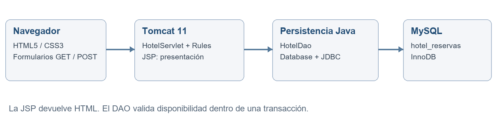
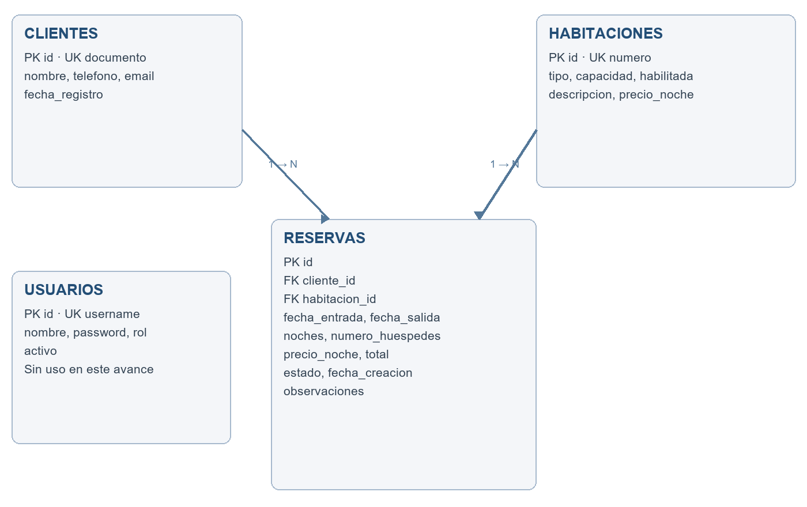

# FACULTAD DE INGENIERÍA

PROGRAMA INGENIERÍA DE SISTEMAS E INFORMÁTICA

CURSO DESARROLLO WEB INTEGRADO

NRC: pendiente de completar por el equipo

INFORME DE AVANCE DE PROYECTO FINAL 1 (APF1)

Sistema de Gestión y Reservas Hoteleras

Integrantes del equipo:

1. Acosta Loyola, Jorge Eduardo – U22205593.
2. Anchorena Pérez, César – U18209414.
3. Zea Carrasco, Sandro Johnatan – código pendiente de completar.

Docente: Mtro. Ing. CÁRDENAS LATORRE CÉSAR

Fecha de presentación: 05 / 09 / 2026

<!-- PAGEBREAK -->

# ÍNDICE DE LA ESTRUCTURA APF1

1. INTRODUCCIÓN Y OBJETIVOS
   1.1. Descripción general de la aplicación web a desarrollar.
   1.2. Objetivos del sistema basados en arquitectura Java EE.

2. ARQUITECTURA DEL ENTORNO Y CONFIGURACIÓN (WEB CONTAINER)
   2.1. Configuración del Servidor Web / Contenedor.
   2.2. Configuración del Entorno de Desarrollo.

3. DISEÑO DE LA INTERFAZ FRONT-END ESTÁTICA
   3.1. Estructura de vistas utilizando HTML5 y CSS3.
   3.2. Pantallas principales del prototipo web integrado.

4. IMPLEMENTACIÓN DE LA CONEXIÓN A BASE DE DATOS (JDBC)
   4.1. Diseño del esquema de base de datos relacional.
   4.2. Implementación de clases de conexión y pruebas mediante JDBC.

5. DESARROLLO CON JAVA SERVER PAGES (JSP) Y SERVLETS BÁSICOS
   5.1. Implementación de páginas dinámicas iniciales usando fundamentos JSP.
   5.2. Envío y recepción de parámetros entre formularios HTML y el servidor.

6. EVIDENCIAS Y CÓDIGO FUENTE
   6.1. Fragmentos de código más relevantes.
   6.2. Enlace al repositorio de código (GitHub).

Referencias técnicas

Estado del avance: aplicación compilada y desplegada en Tomcat, conectada a la base existente y verificada mediante pruebas Java/JDBC y HTTP. La revisión visual en navegador y los datos académicos marcados como pendientes requieren completarse antes de la entrega definitiva.

<!-- PAGEBREAK -->

# 1. INTRODUCCIÓN Y OBJETIVOS

## 1.1. Descripción general de la aplicación web a desarrollar

El Sistema de Gestión y Reservas Hoteleras centraliza el registro de huéspedes, la consulta de habitaciones y la administración de reservas. Está dirigido al personal de recepción de un hotel que necesita identificar a sus clientes, conocer las tarifas y organizar las estancias sin asignar una habitación a dos reservas en fechas superpuestas.

El problema abordado es la dispersión de información que puede producirse al registrar las reservas en documentos independientes. El sistema relaciona cada estancia con un huésped y una habitación, conserva su tarifa contratada y permite seguir su estado. El panel reúne indicadores de ocupación confirmada para hoy, reservas pendientes, huéspedes registrados y valor histórico confirmado.

Para el prototipo se utiliza la identidad visual ficticia «Casa Serena». La aplicación se ejecuta localmente en http://localhost:8080/hotel/ y trabaja con la base MySQL existente hotel_reservas. Se identificaron cinco habitaciones previamente registradas: 101, 102, 201, 202 y 301. Se conservaron sus descripciones, capacidades y tarifas; no se sustituyó el esquema por una base de demostración.

El flujo implementado comprende registrar al huésped, elegir habitación y fechas, revisar el importe estimado, guardar la reserva pendiente y luego confirmarla o cancelarla. Tanto las pendientes como las confirmadas bloquean las fechas; las canceladas dejan de bloquearlas. La salida de una reserva puede coincidir con la entrada de otra.

## 1.2. Objetivos del sistema basados en arquitectura Java EE

Objetivo general: desarrollar un prototipo web integrado de gestión hotelera utilizando la arquitectura de presentación, control y persistencia propia de las aplicaciones Java EE, adaptada al espacio de nombres Jakarta requerido por Tomcat 11.

Objetivos específicos:

- Implementar vistas HTML5 y CSS3 con navegación consistente, formularios asociados a etiquetas y adaptación mediante consultas de medios.
- Procesar solicitudes GET y POST con Servlets y presentar información dinámica mediante JSP.
- Conectar la aplicación a MySQL usando JDBC y consultas parametrizadas.
- Validar fechas, capacidad, longitud de campos, documentos únicos y disponibilidad en el servidor.
- Mantener la integridad de la reserva mediante transacciones, bloqueo de habitación y reversión ante errores.
- Verificar el comportamiento mediante pruebas unitarias, integración JDBC y solicitudes HTTP contra Tomcat.

Alcance APF1: panel, catálogo de habitaciones, registro y búsqueda de huéspedes, creación y listado de reservas, confirmación y cancelación. No se implementan pagos, facturación, autenticación, roles ni registro operacional de check-in/check-out. La tabla usuarios permanece disponible para una iteración posterior. Por ello, esta versión corresponde a una demostración académica local.

<!-- PAGEBREAK -->

# 2. ARQUITECTURA DEL ENTORNO Y CONFIGURACIÓN (WEB CONTAINER)

## 2.1. Configuración del Servidor Web / Contenedor

Se utilizó Apache Tomcat 11.0.24, instalado y previamente levantado en C:\apache-tomcat-11.0.24. El conector HTTP configurado escucha en el puerto 8080. El proceso existente emplea JDK 25.0.3; no fue necesario detenerlo ni sustituir su instalación. El archivo hotel.war se copió al directorio webapps, permitiendo su despliegue automático bajo el contexto /hotel.

Tomcat 11 implementa Jakarta Servlet 6.1 y Jakarta Pages 4.0, y requiere Java 17 o posterior [1]. En consecuencia, las clases usan jakarta.servlet y no javax.servlet. El término Java EE del curso se mantiene como referencia arquitectónica, explicando su evolución hacia Jakarta EE. Tomcat es un contenedor Servlet/JSP y no un servidor que implemente por sí solo toda la plataforma Jakarta EE.

La aplicación sigue un esquema MVC simplificado. HotelServlet recibe las solicitudes; Rules valida reglas de negocio; HotelDao ejecuta consultas y transacciones; Database obtiene las conexiones; las JSP generan el HTML. Las vistas se alojan en WEB-INF/views para impedir su acceso directo. JavaScript actualiza la estimación de la reserva, mientras el servidor calcula el importe definitivo.



Las credenciales se leen de conf/hotel-db.properties, fuera del código fuente y del WAR. También se admiten variables de entorno. La configuración local utiliza el usuario root solicitado en el enunciado. La contraseña real no se reproduce en el informe ni en los archivos preparados para GitHub.

## 2.2. Configuración del Entorno de Desarrollo

| Componente | Configuración verificada |
|---|---|
| Compilación | Eclipse Temurin JDK 21.0.6; bytecode objetivo Java 21 |
| Construcción | Apache Maven 3.9.11; proyecto con empaquetado WAR |
| Ejecución web | Tomcat 11.0.24; JDK 25.0.3; HTTP 8080 |
| Base de datos | MySQL Community Server 9.0.1; esquema hotel_reservas |
| Controlador JDBC | MySQL Connector/J 9.7.0 |
| Verificación | JUnit Jupiter 5.11.4; Maven Surefire 3.5.2 |

El proyecto Maven puede abrirse en Visual Studio Code con las extensiones de Java, o importarse como proyecto Maven en Eclipse o NetBeans. La compilación y las pruebas se ejecutaron mediante Maven en PowerShell, sin atribuir una validación del IDE que no se realizó. Los scripts build.ps1 y deploy.ps1 reproducen el proceso en el equipo.

<!-- PAGEBREAK -->

# 3. DISEÑO DE LA INTERFAZ FRONT-END ESTÁTICA

## 3.1. Estructura de vistas utilizando HTML5 y CSS3

La interfaz dispone de una barra lateral para navegar entre Vista general, Reservas, Habitaciones y Huéspedes; una cabecera contextual; y un área principal con tarjetas y formularios. Se utilizan elementos semánticos HTML5 como aside, nav, header, main, section, article y footer. Los formularios asocian cada campo con su etiqueta y las tablas separan encabezados y registros.

La hoja app.css define una paleta verde oscuro y tonos neutros, tipografía de sistema para los controles y serif para títulos principales. Grid y Flexbox distribuyen indicadores, tarjetas y columnas. Las consultas de medios a 1150, 850 y 560 píxeles reorganizan la navegación y los formularios. Las tablas cuentan con desplazamiento horizontal en espacios reducidos. No se requieren CDN, fuentes descargadas ni imágenes externas; las ilustraciones del hotel se construyen con CSS.

Las vistas incluyen estados vacíos orientados a la siguiente acción, mensajes de éxito y mensajes de error. Los campos utilizan required, minlength, maxlength, min, max y tipos text, email y number. Las fechas se ingresan y presentan en formato día/mes/año (dd/mm/aaaa), con validación estricta en Java y JavaScript. Estas validaciones mejoran la interacción, pero las reglas importantes se verifican nuevamente en Java. Los datos de los usuarios se escapan antes de incorporarlos al HTML.

## 3.2. Pantallas principales del prototipo web integrado

| Pantalla y ruta | Función implementada |
|---|---|
| Vista general: /panel | Indicadores, próximas estancias y ocupación confirmada del día |
| Reservas: /reservas | Búsqueda por huésped, documento o ID; filtro por estado; confirmar y cancelar |
| Habitaciones: /habitaciones | Catálogo con número, tipo, capacidad, descripción y tarifa |
| Huéspedes: /huespedes | Directorio, búsqueda y formulario de registro |
| Nueva reserva: /nueva-reserva | Selección de huésped, habitación, fechas, cantidad y observaciones |

La pantalla Nueva reserva muestra un resumen con tarifa, noches, huéspedes e importe estimado. Si no existen huéspedes, indica que se debe registrar uno antes y deshabilita el envío. La selección de una habitación desde el catálogo se traslada al formulario mediante el parámetro habitacion.

Para consultar la base visual estática se incluyen copias HTML de las respuestas del servidor en docs/prototipo, junto con sus estilos y JavaScript. Son referencias de lectura, no una aplicación independiente: las acciones requieren el contexto /hotel en Tomcat. Las copias se generaron sin registros personales de prueba y sin conservar el token CSRF de una sesión real.

Verificación de esta sección: las cinco rutas devolvieron HTTP 200 y contenido HTML en español. No hubo un navegador conectado a la sesión de desarrollo, por lo que las evidencias no incluyen capturas de pantalla ni acreditan una inspección visual interactiva. Debe revisarse el resultado en escritorio y móvil antes de la exposición académica.

<!-- PAGEBREAK -->

# 4. IMPLEMENTACIÓN DE LA CONEXIÓN A BASE DE DATOS (JDBC)

## 4.1. Diseño del esquema de base de datos relacional

Se inspeccionó el esquema hotel_reservas antes de desarrollar la aplicación. Las cuatro tablas utilizan InnoDB y codificación utf8mb4. clientes almacena los huéspedes; habitaciones contiene el inventario; reservas relaciona ambas entidades; usuarios conserva la estructura destinada a un acceso futuro. No se alteraron ni eliminaron las tablas existentes.



Cada cliente puede realizar cero o muchas reservas y cada habitación puede recibir cero o muchas reservas en el tiempo. Cada reserva pertenece a un único cliente y una única habitación, mediante claves foráneas no nulas. documento y numero tienen restricciones de unicidad en clientes y habitaciones, respectivamente.

| Tabla | Atributos principales y restricciones |
|---|---|
| clientes | id PK; documento UNIQUE; nombre; teléfono; email opcional; fecha_registro |
| habitaciones | id PK; numero UNIQUE; tipo ENUM; capacidad; precio_noche DECIMAL; habilitada BIT |
| reservas | id PK; cliente_id FK; habitacion_id FK; fechas; noches; huéspedes; tarifa; total; estado |
| usuarios | id PK; username UNIQUE; password; nombre; rol; activo. Conservada, sin uso en APF1 |

Las reservas guardan precio_noche y total como valores históricos, aunque la habitación tenga una tarifa actual. Se utiliza BigDecimal para multiplicar la tarifa por la cantidad de noches, evitando aritmética binaria de punto flotante en los importes. El esquema completo, incluidos tipos y restricciones originales, se encuentra en sql/schema.sql.

La restricción de no superposición se aplica en la transacción de reserva: se bloquea la fila de la habitación con SELECT ... FOR UPDATE; se consultan reservas no canceladas cuyo inicio sea anterior a la nueva salida y cuya salida sea posterior a la nueva entrada; solo si no hay conflictos se inserta la reserva. Los extremos se tratan como [entrada, salida), permitiendo estancias consecutivas.

<!-- PAGEBREAK -->

## 4.2. Implementación de clases de conexión y pruebas mediante JDBC

Database.open() carga com.mysql.cj.jdbc.Driver y obtiene una conexión mediante DriverManager.getConnection. La configuración se toma de variables de entorno o del archivo hotel-db.properties ubicado en conf de Tomcat. Connector/J se incorpora mediante la dependencia Maven com.mysql:mysql-connector-j:9.7.0 [2].

HotelDao concentra las consultas SQL. Los valores se transmiten con PreparedStatement, sin concatenar parámetros del formulario dentro del SQL. Los bloques try-with-resources cierran conexiones, sentencias y resultados. reserve() desactiva autoCommit; aplica los bloqueos y validaciones; confirma con commit cuando la inserción termina; y ejecuta rollback ante SQLException o una excepción de validación.

La lectura de la habitación incluye su estado habilitada y capacidad. Una habitación no habilitada no puede reservarse. La fecha de entrada no puede ser anterior al día actual de Lima; la estancia debe abarcar entre 1 y 365 noches y el número de huéspedes debe estar entre 1 y la capacidad. La tarifa enviada por el navegador nunca se utiliza como precio definitivo: se obtiene nuevamente de MySQL.

El modelo de bloqueo serializa las reservas concurrentes de una misma habitación. Esta garantía corresponde a los escritores que usan el flujo transaccional implementado. Otro sistema que escriba directamente en reservas sin respetar ese bloqueo podría introducir conflictos; por ello, todos los escritores de una futura integración deben aplicar la misma regla.

Pruebas de integración ejecutadas:

- Persistencia de una reserva de tres noches a S/ 145.00, obteniendo un total de S/ 435.00; rechazo de una superposición y aceptación de una estancia adyacente.
- Confirmación y cancelación; liberación de disponibilidad; rechazo de reactivación de una cancelada.
- Reversión de la transacción cuando se utiliza un cliente inexistente.
- Dos solicitudes concurrentes para la misma habitación y fechas: una sola finalizó correctamente.
- Rechazo de un documento de huésped duplicado por la restricción UNIQUE.

Se utilizaron registros temporales identificados exclusivamente para las pruebas y se eliminaron al finalizar. Los identificadores autoincrementales pueden presentar saltos como consecuencia normal de estas inserciones. No se renumeraron registros ni se reiniciaron secuencias.

El resultado fue cinco pruebas JDBC aprobadas y seis pruebas unitarias aprobadas, sin errores ni omisiones en la ejecución con HOTEL_INTEGRATION=true. Los archivos de resultado se conservan en docs/evidencias/pe.edu.hotel.DatabaseTest.txt y pe.edu.hotel.RulesTest.txt.

<!-- PAGEBREAK -->

# 5. DESARROLLO CON JAVA SERVER PAGES (JSP) Y SERVLETS BÁSICOS

## 5.1. Implementación de páginas dinámicas iniciales usando fundamentos JSP

HotelServlet está mapeado con @WebServlet a las cinco rutas funcionales. En doGet consulta habitaciones, huéspedes y reservas; asigna los resultados como atributos de la solicitud; y utiliza RequestDispatcher.forward para renderizar WEB-INF/views/app.jsp. La JSP establece UTF-8 y utiliza directivas, expresiones y bloques de control para mostrar el contenido según la ruta.

El uso de scriptlets es deliberado para demostrar los fundamentos JSP solicitados en APF1. La vista no abre conexiones ni ejecuta SQL. La lógica de persistencia está en HotelDao y las reglas de validación en Rules. En una siguiente iteración puede reemplazarse la iteración con JSTL y Expression Language para reducir el código Java presente en las vistas.

Web.esc() transforma los caracteres especiales de datos variables antes de mostrarlos. Web.money() presenta los importes según la configuración es-PE. El panel distingue la ocupación confirmada del día del valor histórico de reservas confirmadas; este último no representa cobros ni caja.

## 5.2. Envío y recepción de parámetros entre formularios HTML y el servidor

| Operación | Método y parámetros |
|---|---|
| Buscar huéspedes | GET /huespedes: q |
| Buscar reservas | GET /reservas: q, estado |
| Registrar huésped | POST /huespedes: action=guest, csrf, nombre, documento, telefono, email |
| Crear reserva | POST /nueva-reserva: action=reserve, csrf, cliente, habitacion, entrada, salida, personas, observaciones |
| Cambiar estado | POST /reservas: action=state, csrf, id, estado |

El controlador configura la codificación antes de leer los parámetros. Verifica que el token CSRF recibido coincida con el de la sesión, transforma fechas e identificadores y delega en el DAO. Tras guardar correctamente utiliza sendRedirect, evitando que una recarga repita el POST. El mensaje de éxito se almacena temporalmente en la sesión y se elimina al mostrarse.

Una validación inválida produce HTTP 400 y vuelve a mostrar el formulario con sus valores; un documento duplicado produce HTTP 409; un token CSRF incorrecto produce HTTP 403. Ante un problema JDBC de lectura se responde HTTP 503 con un mensaje general, mientras los detalles se registran en el log de Tomcat. Se incluyen cabeceras contra interpretación incorrecta del contenido y uso del sitio dentro de marcos.

La sesión utilizada para CSRF no equivale a una sesión de autenticación: cualquier persona con acceso al prototipo local puede operar las funciones. La incorporación de usuarios, contraseñas y permisos queda expresamente fuera de este avance.

<!-- PAGEBREAK -->

# 6. EVIDENCIAS Y CÓDIGO FUENTE

## 6.1. Fragmentos de código más relevantes

Conexión JDBC, extracto de Database.java. user, password y url proceden de la configuración externa:

```java
Class.forName("com.mysql.cj.jdbc.Driver");
return DriverManager.getConnection(url, user, password);
```

Control de disponibilidad, SQL empleado en HotelDao.java con parámetros preparados:

```sql
SELECT id FROM reservas
WHERE habitacion_id = ?
  AND estado <> 'CANCELADA'
  AND fecha_entrada < ?
  AND fecha_salida > ?
FOR UPDATE
```

Antes de esta consulta se bloquea la habitación mediante SELECT ... FOR UPDATE. Los parámetros de fechas se asignan en el orden nueva salida, nueva entrada. Todas las operaciones ocurren en la misma conexión transaccional.

Construcción de la vista desde el Servlet, extracto equivalente al flujo implementado:

```java
req.setAttribute("rooms", dao.rooms());
req.getRequestDispatcher("/WEB-INF/views/app.jsp")
   .forward(req, res);
```

JSP y HTML, fragmento abreviado de la presentación de un huésped. e() delega en Web.esc():

```jsp
<%@ page contentType="text/html;charset=UTF-8" %>
<strong><%=e(g.get("nombre"))%></strong>
```

CSS, organización de dos campos en una fila y adaptación móvil, extracto normalizado de app.css:

```css
.form-row {
  display: grid;
  grid-template-columns: 1fr 1fr;
  gap: 20px;
}
@media (max-width: 560px) {
  .form-row { grid-template-columns: 1fr; }
}
```

El código íntegro y ejecutable se entrega en src; los fragmentos del informe omiten contexto para facilitar su explicación durante la exposición.

<!-- PAGEBREAK -->

## 6.1. Evidencias de ejecución y verificación (continuación)

Se generó target/hotel.war mediante Maven y se desplegó en el Tomcat existente. Las cinco pantallas respondieron HTTP 200. El archivo docs/evidencias/http-resultados.json documenta 17 comprobaciones realizadas contra http://localhost:8080/hotel, incluyendo los envíos de formularios y la consulta posterior de los datos persistidos.

| Grupo de evidencia | Resultado observado |
|---|---|
| Pruebas unitarias | 6 aprobadas: noches, pasado, duración, capacidad y escape HTML |
| Integración JDBC | 5 aprobadas: persistencia, estados, rollback, concurrencia y documento único |
| Rutas de la aplicación | 5 respuestas HTTP 200 con HTML en español |
| Formularios HTTP | Registro de huésped y reserva; total persistido S/ 435.00 |
| Rechazos HTTP | CSRF 403; duplicado 409; fechas, capacidad y superposición 400 |
| Flujo y filtros HTTP | Confirmación, cancelación, búsqueda y nueva reserva tras cancelar |

Las pruebas HTTP utilizaron un huésped y una habitación temporales. Tras confirmar sus resultados se eliminaron las reservas y los registros creados para ellas. Los datos originales se conservaron. Los resultados no sustituyen una revisión visual: el navegador no estuvo disponible en la sesión, por lo que las copias HTML se entregan como referencia de interfaz, no como capturas verificadas.

Para reproducir la compilación y las pruebas Java/JDBC en el equipo:

```powershell
powershell -ExecutionPolicy Bypass `
  -File scripts/build.ps1 -Integration
powershell -ExecutionPolicy Bypass `
  -File scripts/deploy.ps1
```

El script scripts/http_smoke.py reproduce las pruebas HTTP con la biblioteca estándar de Python. Requiere Tomcat, MySQL, el cliente mysql.exe y el archivo local de configuración. La aplicación Java no depende de Python para funcionar.

## 6.2. Enlace al repositorio de código (GitHub)

URL del repositorio: https://github.com/Jorgean123/SistemaGestionReservasHoteleras

El repositorio fue creado en la cuenta Jorgean123 para alojar el código fuente, esquema SQL, documentación y evidencias del avance. La publicación está pendiente de habilitar acceso de escritura a la conexión GitHub: el intento de subida devolvió HTTP 403, Resource not accessible by integration. El proyecto está preparado localmente en la rama main. El archivo .gitignore excluye dependencias descargadas, archivos temporales y artefactos de compilación. La contraseña de MySQL permanece en la configuración local de Tomcat y no forma parte de los archivos preparados para publicar.

Antes de la entrega académica deben completarse el NRC del curso, el código universitario del tercer integrante y la revisión visual de las pantallas. El código, los scripts SQL, el manual de ejecución y las evidencias funcionales se incluyen también en la entrega local.

<!-- PAGEBREAK -->

# REFERENCIAS TÉCNICAS

[1] Apache Software Foundation. Apache Tomcat 11 Migration Guide. Compatibilidad con Java 17 o posterior y especificaciones Jakarta Servlet 6.1 y Jakarta Pages 4.0. Consulta: 05/09/2026.

https://tomcat.apache.org/migration-11.0.html

[2] Oracle. MySQL Connector/J Developer Guide: Installing Connector/J Using Maven. Dependencia oficial de Connector/J. Consulta: 05/09/2026.

https://dev.mysql.com/doc/connector-j/en/connector-j-installing-maven.html

[3] Apache Software Foundation. Apache Tomcat Configuration Reference. Organización y configuración del contenedor. Consulta: 05/09/2026.

https://tomcat.apache.org/tomcat-11.0-doc/config/index.html

Fuentes locales de evidencia: pom.xml; configuración del Tomcat existente; metadatos y SHOW CREATE TABLE de hotel_reservas; código Java/JSP/CSS; reportes de JUnit y resultados de solicitudes HTTP. Las versiones del equipo corresponden a la inspección local realizada el 05/09/2026.
